# 品牌總入口網站 V2.0

和顏悦舍的品牌總入口網站 —— 一張 NFC 卡，串起度假小屋、美妝保養、女裝服飾三個品牌。

**線上網址：** https://brand-portal-hxu.vercel.app/

## 解決什麼問題

一個經營者手上有三個品牌，每個品牌又各有 Facebook、Instagram、LINE、賣場、訂房頁。
客人想找其中一個，往往要在好幾個平台之間來回翻。

這個網站把所有入口收進同一頁：

- **一次感應就到位** —— 客人用手機輕觸 NFC，馬上看到三個品牌與各自的社群、賣場、訂房連結。
- **住客的旅遊小幫手** —— 度假小屋另有「體驗中心」，美食地圖、附近景點、半日遊／一日遊路線、交通方式一應俱全，全部可一鍵開啟 Google Maps 導航。
- **資訊自己會更新** —— 空房狀況每小時同步、台東最新活動每天自動更新，經營者不必手動維護。

## 簡易動畫

<p align="center">
  
</p>

```
/                首頁 —— 三張品牌卡片（度假小屋 / 美妝保養 / 女裝服飾）
└── /stay        度假小屋體驗中心：立即訂房、環境介紹、空房查詢、在地體驗、我們的位置
    ├── /food-map     美食地圖 —— 4 分類 23 家店
    ├── /attractions  附近景點 —— 依距離分組
    ├── /itineraries  半日遊・一日遊 —— 四條路線
    ├── /transport    交通方式 —— 五種抵達方式
    └── /events       台東最新活動 —— 每日自動更新
```

## 用了哪些技術？以及為什麼？

| 技術 | 為什麼選它 |
| --- | --- |
| **React 19** | 頁面由大量重複的卡片組成（品牌、店家、景點、行程），元件化讓一份樣式套用到所有資料。 |
| **Vite 8** | 開發時秒開、即時熱更新；build 出來是純靜態檔案，任何靜態主機都能放。 |
| **Tailwind CSS 4** | 設計 token（配色、字型、動畫）集中寫在 `src/index.css` 的 `@theme`，改一處就換掉整站風格，不需要額外設定檔。 |
| **React Router 7** | 七個頁面共用 Header / Footer，換頁不重新載入，手機上切換更順。 |
| **lucide-react** | 輕量、可 tree-shake 的 icon；社群品牌 icon 則自製 SVG，風格一致。 |
| **sharp** | 把相機原檔批次轉成 WebP、依 EXIF 轉正並移除 GPS 資訊，照片又小又安全。 |
| **GitHub Actions** | 免費的排程器，負責抓空房日曆與台東活動，有變動才 commit。 |
| **Vercel** | 推上 GitHub 就自動部署，全球 CDN，免維護伺服器。 |
| **TDX 開放資料** | 交通部觀光署官方的觀光活動 API，資料權威、免費。 |
| **Google 日曆 iCal** | 經營者原本就用 Google 日曆記訂房，直接拿來當空房資料來源，零學習成本。 |

整站是**純前端、零後端**：沒有資料庫、沒有伺服器要顧，維運成本趨近於零。

## 架構

```
  TDX 觀光活動 API                    Google 日曆 iCal
        │ 每天 05:00                         │ 每小時
        ▼                                    ▼
  [GitHub Actions]                    [GitHub Actions]
  fetch-taitung-events.mjs            fetch-availability.mjs
        │  （純邏輯在 scripts/lib，皆有單元測試）│
        ▼                                    ▼
  events.generated.json               availability.generated.json
        │                                    │
        └──────────── 有變動才 commit ────────┘
                           │
                           ▼
  src/data/*.js（手動內容）──► React 元件 ──► Vite build ──► Vercel 自動部署
```

**資料與 UI 完全分離**：元件不知道有幾個品牌、幾家店，所有內容都從 `src/data/` 讀取。
要改文字、連結、店家、景點，**只動資料檔，不碰任何元件**。

```
src/
├── pages/        7 個頁面
├── components/   可重用的卡片、月曆、相簿、路線站點等元件
├── data/         ★ 所有內容（手動維護 + 自動產生的 JSON）
└── index.css     設計 token
scripts/          資料抓取與圖片最佳化腳本
.github/workflows 兩條自動更新排程
```

## 工程亮點

- **自動化資料管線** —— 空房與活動資料由排程自動抓取、產生 JSON、commit、部署，全程無人工介入；且只在資料真的改變時才 commit，git 歷史乾淨。
- **訂房邏輯嚴謹且有測試** —— iCal 解析正確處理全天事件 `DTEND` 不含當日的規則（9/10 入住、9/12 退房＝兩晚），並以 `node:test` 覆蓋邊界情境。
- **隱私優先** —— 解析時只讀取日期欄位、刻意不讀活動標題，客人姓名不會進入公開 repo；環境照自動清除含 GPS 的 EXIF，並支援以座標遮蔽車牌、門牌。
- **時區正確** —— 活動「進行中」的判斷固定以台北時間計算，不受 GitHub Actions 的 UTC 環境影響。
- **圖片最佳化** —— 26 張相機原檔約 97 MB，經腳本壓成 WebP 後約 5.5 MB，縮小約 94%。
- **Fail-safe 進場動畫** —— `Reveal` 元件以 IntersectionObserver 實作，並處理背景分頁、舊瀏覽器等情境，保證內容一定會顯示。
- **無障礙** —— 語意標籤、完整鍵盤操作、「跳至主要內容」、`aria-label` / `aria-pressed`、尊重 `prefers-reduced-motion`。
- **SEO 完整** —— title / description / canonical / Open Graph / Twitter Card / JSON-LD 一應俱全，分享到社群有漂亮的預覽卡片。
- **SPA 直連不 404** —— `vercel.json` 設定 rewrite，任何子頁面都能直接開啟或重新整理。

## 快速開始

```bash
npm install
npm run dev        # 開啟 http://localhost:5173
```

其他指令：

```bash
npm run build                 # 產生 dist/
npm run preview               # 在本機預覽 build 結果
npm test                      # 執行資料解析的單元測試
npm run optimize:images       # 把 assets-src/stay/ 的原檔壓成 WebP
npm run update:availability   # 手動更新空房資料
```

自動更新台東活動需在 GitHub 設定 Secret：`TDX_CLIENT_ID`、`TDX_CLIENT_SECRET`
（Settings → Secrets and variables → Actions）。

## 深入閱讀

- [內容維護手冊](docs/maintenance.md) —— 完整專案結構，以及如何修改品牌、店家、景點、行程、圖片與空房日曆
- [空房日曆設計文件](docs/superpowers/specs/2026-09-04-room-availability-calendar-design.md)
- [空房日曆實作計畫](docs/superpowers/plans/2026-09-04-room-availability-calendar.md)
- [TDX 運輸資料流通服務](https://tdx.transportdata.tw/)

## 授權

© 2026 和顏悦舍。保留所有權利。
